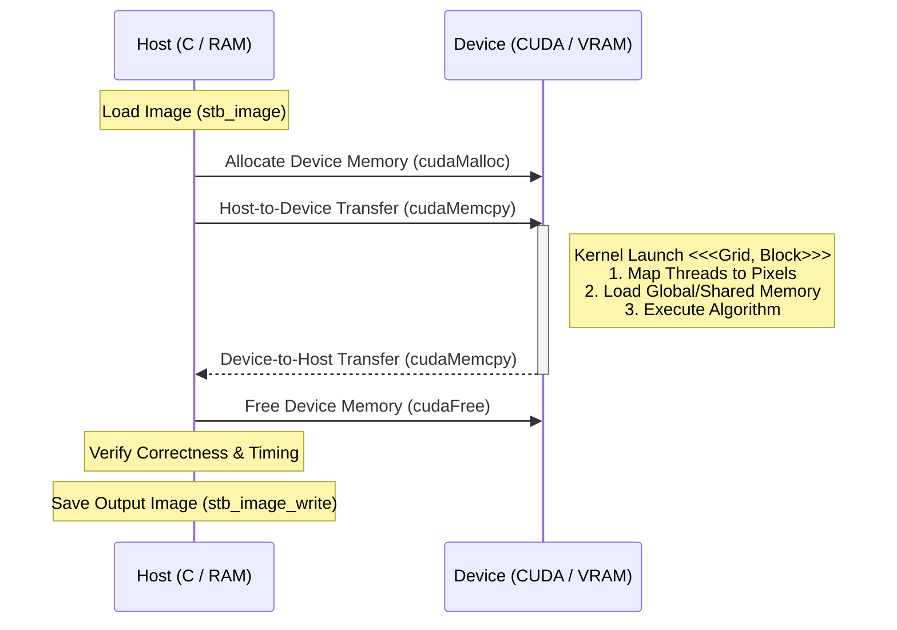

<a id="readme-top"></a>
<!-- PROJECT LOGO -->
<br />
<div align="center">
  <h1 align="center">CUDA Image Processing Benchmark</h1>

  <p align="center">
    A native C and CUDA-based benchmark comparing CPU vs. GPU acceleration for fundamental image processing algorithms.
    <br />
    <a href="docs/methodology.md"><strong>Explore the Methodology »</strong></a>

  </p>
</div>

<!-- TABLE OF CONTENTS -->
<details>
  <summary>Table of Contents</summary>
  <ol>
    <li>
      <a href="#about-the-project">About The Project</a>
      <ul>
        <li><a href="#why-cuda">Why CUDA?</a></li>
        <li><a href="#cuda-concepts-demonstrated">CUDA Concepts Demonstrated</a></li>
        <li><a href="#architecture">Architecture</a></li>
      </ul>
    </li>
    <li>
      <a href="#getting-started">Getting Started</a>
      <ul>
        <li><a href="#prerequisites">Prerequisites</a></li>
        <li><a href="#installation--build">Installation & Build</a></li>
      </ul>
    </li>
    <li><a href="#usage">Usage</a></li>
    <li><a href="#benchmarking--results">Benchmarking & Results</a></li>
    <li><a href="#roadmap--future-improvements">Roadmap / Future Improvements</a></li>
    <li><a href="#contributing">Contributing</a></li>
    <li><a href="#license">License</a></li>
    <li><a href="#acknowledgments">Acknowledgments</a></li>
  </ol>
</details>

## About The Project

This project serves as a comprehensive benchmark to compare standard CPU execution (written in native C) versus GPU execution (written in CUDA C++) for fundamental image processing algorithms. It measures execution and memory-transfer times, strictly verifies GPU correctness against the CPU implementation, and reports exact GPU speedup metrics.

The algorithms implemented include:
* **Grayscale**
* **Brightness Adjustment**
* **Image Invert**
* **Gaussian Blur (3x3)**
* **Sobel Edge Detection**

### Why CUDA?
Image processing operations are highly parallelizable because the computation for each pixel is mostly independent of others. While a CPU processes pixels sequentially, a GPU, equipped with thousands of cores, can execute an operation on millions of pixels simultaneously, offering massive speedups for large datasets.

### CUDA Concepts Demonstrated
* **Threads and Blocks**: Launching thousands of threads organized in a 2D grid of thread blocks.
* **Shared Memory**: Using fast on-chip `__shared__` memory for neighborhood operations (convolution) to minimize slow global memory accesses.
* **Synchronization**: Using `__syncthreads()` to synchronize threads within a block before accessing shared memory.
* **CUDA Events**: Utilizing `cudaEventRecord()` and `cudaEventElapsedTime()` for precise hardware-level GPU timing.
* **C/CUDA Interoperability**: Interfacing standard C host code with C++-based `nvcc` device code safely using `extern "C"`.

### Architecture


## Getting Started

To get a local copy up and running, follow these simple steps.

### Prerequisites

Ensure you have a CUDA-capable machine set up with the following:
* **NVIDIA GPU** (Compute Capability 3.0+)
* **NVIDIA display driver**
* **CUDA Toolkit** (`nvcc`)
* **CMake** (3.14+)
* **C99 compatible compiler** (`gcc`, `clang`)

You can verify your environment using:
```bash
nvidia-smi
nvcc --version
cmake --version
gcc --version
```

### Installation & Build

1. Clone the repo
   ```bash
   git clone https://github.com/your_username/cuda-image-benchmark.git
   cd cuda-image-benchmark
   ```
2. Create a build directory and configure CMake
   ```bash
   mkdir build && cd build
   cmake ..
   ```
3. Compile the project
   ```bash
   make -j$(nproc)
   ```
   *(Alternatively, a `Makefile` is provided in the root directory. You can just run `make` from the root)*
## Usage

The CLI allows you to specify an input image and the exact operation you want to benchmark. 
**Note: You must execute the binary from within the `build/` directory.**

**Run all benchmarks on a specific image:**
```bash
./cuda_image_benchmark --input /absolute/path/to/image.jpg --operation all
```

**Run a specific operation (e.g., Gaussian Blur):**
```bash
./cuda_image_benchmark --input /absolute/path/to/image.jpg --operation blur
```

**Change brightness value and timing iterations:**
```bash
./cuda_image_benchmark --input /absolute/path/to/image.jpg --operation brightness --value 75 --iterations 20
```

*Note: If no `--input` image is provided, a synthetic 1920x1080 test image will be automatically generated inside `images/input/`.*

## Benchmarking & Results

The project runs the CPU and GPU versions multiple times (default: 10) and calculates the mean time, excluding the first warmup run for the GPU.

The GPU timing is split into:
* **H2D Transfer**: Host to Device memory copy (PCIe bus)
* **Kernel**: Execution time strictly on the GPU cores
* **D2H Transfer**: Device to Host memory copy (PCIe bus)
* **Total GPU**: End-to-end time

Benchmark results are printed to the console and saved to `results/benchmark.csv`. Processed output images are saved in `images/output/`.

### Limitations to Note
* PCIe transfer overhead can heavily outweigh kernel execution time for small images (e.g. 512x512). Massive end-to-end speedups are typically only seen on >1080p images (Amdahl's Law).
## License
Distributed under the MIT License. See `LICENSE` for more information.
<!-- MARKDOWN LINKS & IMAGES -->
[license-shield]: https://img.shields.io/github/license/othneildrew/Best-README-Template.svg?style=for-the-badge
[license-url]: https://github.com/your_username/cuda-image-benchmark/blob/master/LICENSE
[c-shield]: https://img.shields.io/badge/C99-00599C?style=for-the-badge&logo=c&logoColor=white
[c-url]: https://en.cppreference.com/w/c
[cuda-shield]: https://img.shields.io/badge/CUDA-76B900?style=for-the-badge&logo=nvidia&logoColor=white
[cuda-url]: https://developer.nvidia.com/cuda-toolkit
